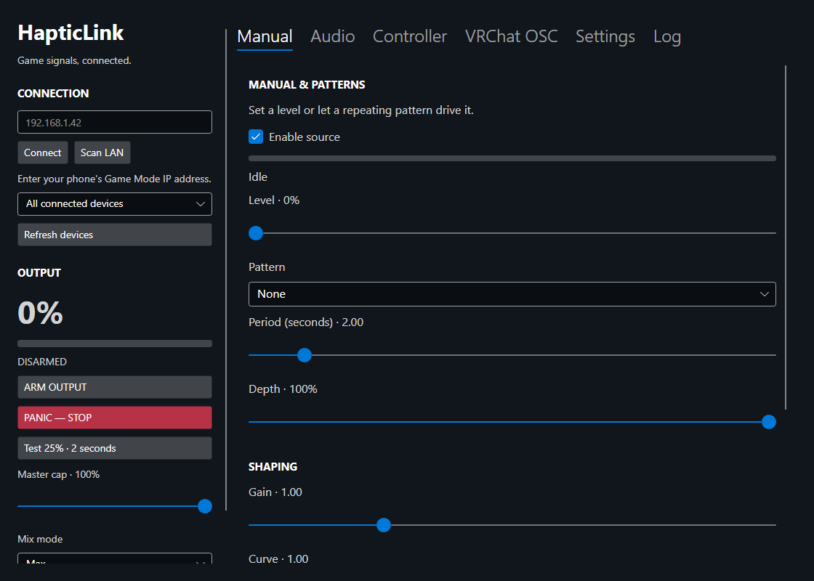

# HapticLink

A desktop app that maps game audio, controller rumble, VRChat OSC and manual patterns to Lovense devices through the Remote app's local Game Mode API.

This repository includes a Linux port and the recovered original Windows application.



## Linux preview

Download `HapticLink-linux-x64.tar.gz` from the [downloads folder](downloads/), extract it, install the dependencies in the [Linux setup guide](src/linux/README-Linux.md), and run `./HapticLink` from the extracted folder. The package includes .NET and targets 64-bit Intel/AMD Linux with glibc. Wayland desktops currently use XWayland.

The Linux version uses Avalonia for the interface, PulseAudio or PipeWire's PulseAudio server for output-monitor audio capture, and an optional Python evdev/uinput bridge for controller rumble. Existing patterns, OSC/SPS processing, per-avatar settings and per-motor routing are retained. Configure a desktop shortcut to `HapticLink --panic` for a global stop command.

**Preview status:** release compilation, 28 C# checks and nine Python tests passed on Windows. The Linux executable has not yet been launched on Linux. Native audio capture, uinput permissions, controller behavior and Steam/Proton routing still need testing on a Linux machine. See the [validation report](src/linux/VALIDATION.md) for exact coverage.

## Source layout

| Path | Contents |
| --- | --- |
| `src/linux/` | Linux application, tests, helper scripts, dependency notices and setup guide |
| `src/windows/` | Original .NET 8 WPF source recovered from a backup, preserved without changes |
| `docs/` | Interface preview |

## Build and check the Linux port

Install .NET SDK 8 or newer, then run from the repository root:

```sh
dotnet run --project src/linux/Tests/HapticLink.Tests.csproj -c Release
python3 -m unittest discover -s src/linux/Tests -p 'test_*.py' -v
dotnet publish src/linux/HapticLink.csproj -c Release -r linux-x64 --self-contained true -o publish/linux-x64
chmod +x publish/linux-x64/HapticLink
```

Audio needs `parec` and `pactl`; controller capture additionally needs Python evdev and permission to access the gamepad and `/dev/uinput`. See [Linux setup](src/linux/README-Linux.md) for distro packages, optional udev rules, VRChat prefixes and shortcuts.

## Windows source

Build `src/windows/HapticLink.csproj` on Windows with .NET SDK 8. The original uses WPF, NAudio/WASAPI and ViGEmBus. Its [original README](src/windows/README.md) describes that version. No rebuilt Windows executable is included in the Linux preview download.

Personal configuration, logs, access tokens and backup images are not part of this repository. Dependency license notices are in `src/linux/licenses/`.
