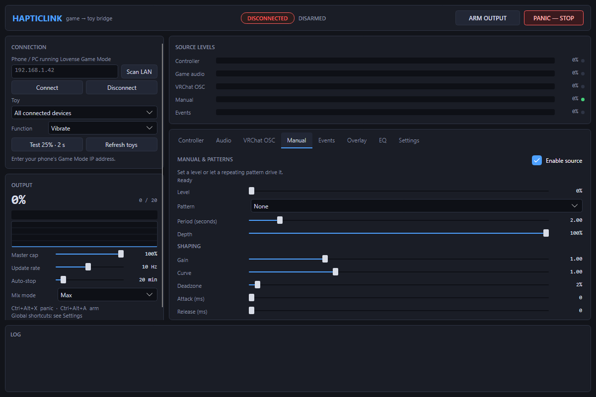
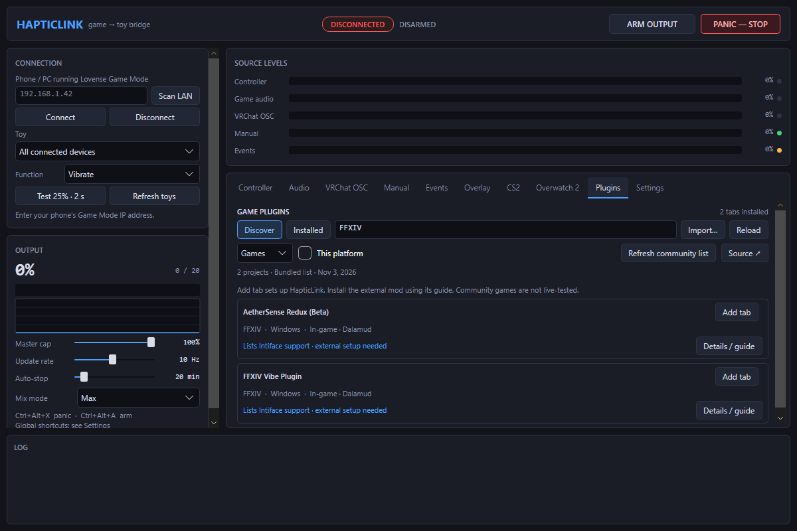
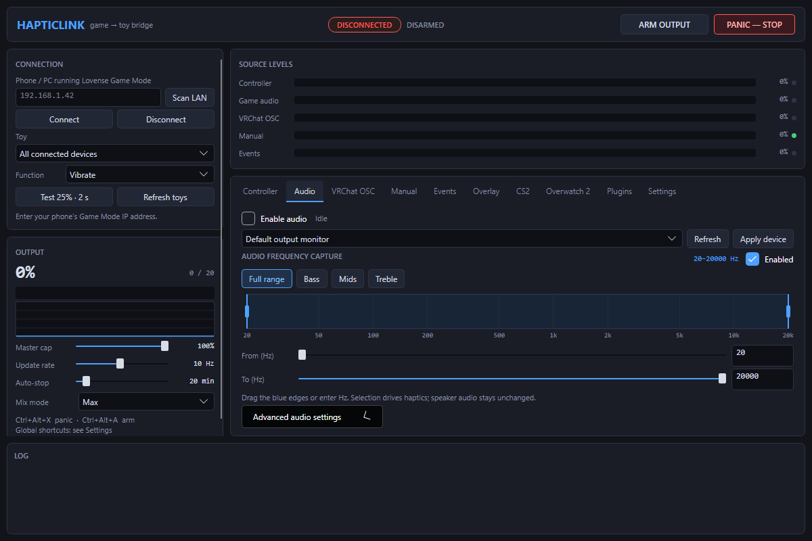
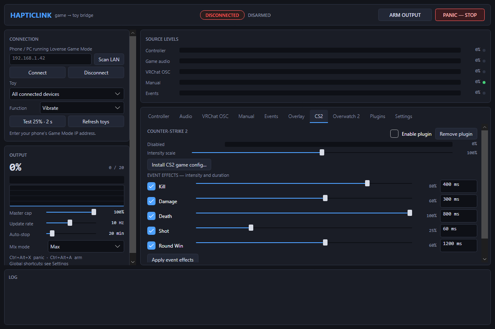
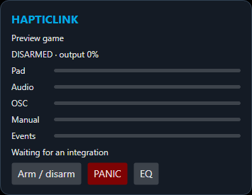

# HapticLink

A desktop app that maps game audio, controller rumble, VRChat OSC and manual patterns to Lovense devices through the Remote app's local Game Mode API.

This repository includes a Linux port and the recovered original Windows application.

The updated 1.5.1 app also has a [Windows build](src/linux/README-Windows.md), with WASAPI output capture and ViGEm/XInput rumble. Per-application audio isolation is currently Linux-only; the overlay, EQ, integration bridge and game-focus pausing are available in the new Windows app.



## 1.5.1 interface update

**Remove plugin** is available directly on each game tab and installed catalog card, with Undo in Plugins. Tab scrolling now includes the full bottom content; expanded sections scroll into view, and option lists can flip/resize at the screen edge. The app has a new link-and-pulse icon for Windows, its window and Linux launcher.

## Community plugin browser

**1.5 preview:** Plugins → Discover searches a community catalog of 69 projects, including 44 game integrations. Refresh the list from the linked community source, filter games/apps and platforms, inspect requirements, and add a connection tab with one click. The bundled list also works offline.

FFXIV Vibe Plugin has its Dalamud repository link and in-game setup steps. Host/port-only clients can be assigned to a game tab, retaining its incoming meter and intensity scale. Adding a tab configures HapticLink; external mods and companions still need their own installation, and individual community games have not been live-tested. [Plugin browser guide](src/linux/PLUGINS.md).



## Game plugins and integrated audio EQ

**1.4 preview:** CS2 and Overwatch 2 come preconfigured as their own tabs. CS2 has ready-made event effects and a game-config installer. Overwatch uses the separate [OverStim](https://codeberg.org/pharmercy/OverStim) companion; its tab can configure the server connection and launch your selected install. Plugins adds/removes game tabs and imports custom integrations. [Game plugin guide](src/linux/PLUGINS.md).

The frequency EQ now lives directly inside Audio, next to device selection. Advanced audio/tonal settings are folded below, and source meters become a compact row in smaller windows.




## Linux preview

**1.2.1 restores the original UI:** compact dark cards, a top-bar arm/panic pair, persistent source meters, inline sliders and a bottom log. Events and overlay remain available, with frequency EQ integrated into Audio. Select bass, mids, treble or an exact capture frequency range with draggable cutoffs.

**1.2 features:** an Intiface/Buttplug-compatible vibration receiver (v2/v3/v4), configurable game-event rules and CS2 GSI, per-application/game audio capture, game-focus pausing, a transparent overlay with click-through/interactive modes, and a frequency-selective haptics EQ. Start with the [integration and overlay guide](src/linux/INTEGRATIONS.md).

Download `HapticLink-linux-x64-1.5.1-preview.tar.xz` from the [downloads folder](downloads/), extract it, install the dependencies in the [Linux setup guide](src/linux/README-Linux.md), and run `./HapticLink` from the extracted folder. The package includes .NET and targets 64-bit Intel/AMD Linux with glibc. Wayland desktops currently use XWayland.



The Linux version uses Avalonia for the interface, PulseAudio or PipeWire's PulseAudio server for output-monitor audio capture, and an optional Python evdev/uinput bridge for controller rumble. Existing patterns, OSC/SPS processing, per-avatar settings and per-motor routing are retained. Configure a desktop shortcut to `HapticLink --panic` for a global stop command.

**Preview status:** release compilation, 156 C# checks (including the official Buttplug client) and nine Python tests passed on Windows. The Windows app has been opened and its WASAPI meter verified. The Linux executable has not yet been launched on Linux; native audio isolation, game focus, overlay click-through, uinput and Steam/Proton routing still need Linux desktop testing. See the [validation report](src/linux/VALIDATION.md).

## Source layout

| Path | Contents |
| --- | --- |
| `src/linux/` | Linux application, tests, helper scripts, dependency notices and setup guide |
| `src/windows/` | Original .NET 8 WPF source recovered from a backup, preserved without changes |
| `docs/` | Interface preview |

## Build and check the Linux port

Install .NET SDK 8 or newer, then run from the repository root:

```sh
dotnet run --project src/linux/Tests/HapticLink.Tests.csproj -c Release
python3 -m unittest discover -s src/linux/Tests -p 'test_*.py' -v
dotnet publish src/linux/HapticLink.csproj -c Release -r linux-x64 --self-contained true -o publish/linux-x64
chmod +x publish/linux-x64/HapticLink
```

Audio needs `parec` and `pactl`; controller capture additionally needs Python evdev and permission to access the gamepad and `/dev/uinput`. See [Linux setup](src/linux/README-Linux.md) for distro packages, optional udev rules, VRChat prefixes and shortcuts.

## Windows source

Build `src/windows/HapticLink.csproj` on Windows with .NET SDK 8. The original uses WPF, NAudio/WASAPI and ViGEmBus. Its [original README](src/windows/README.md) describes that version. No rebuilt Windows executable is included in the Linux preview download.

Personal configuration, logs, access tokens and backup images are not part of this repository. Dependency license notices are in `src/linux/licenses/`.
